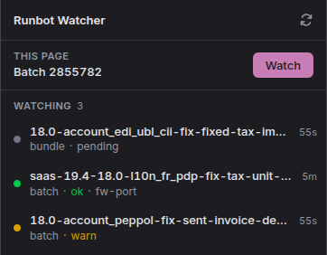

# Runbot Watcher

A lightweight Chrome extension (Manifest V3) that watches Odoo runbot bundles, batches, and builds. It polls the runbot API every minute and sends desktop notifications on errors and completion.




## Features

- **Watch bundles** — tracks the latest batch automatically; switches when a new batch appears
- **Watch batches** — tracks all builds in the batch; notifies when done
- **Watch builds** — tracks a single build (with children); notifies when done
- **Desktop notifications** — instant alerts on errors (`ko` result or ERROR/CRITICAL logs) and on completion, with click-to-open
- **Deduplication** — never notifies twice for the same event
- **Live status** — compact list with a status dot per watch (pending / running / ok / warn / ko) and one shared "checked … ago" timer that ticks while the popup is open
- **Rename** — give a watch your own name (pencil on hover, or double-click the name); empty restores the runbot name
- **Clear done / Clear all** — with **Undo**, like removing a single watch
- **Toolbar icon** — a pulse icon coloured by the overall state: grey (nothing watched), blue (running), green (all OK), red (failures); the badge counts watches in error
- **Light & dark** — follows the system theme

## Install

1. Clone or download this folder
2. Open Chrome and navigate to `chrome://extensions`
3. Enable **Developer mode** (toggle in the top right)
4. Click **Load unpacked** and select the `runbot_watcher` folder
5. The extension icon (a grey pulse) appears in your toolbar

## Usage

1. Navigate to any runbot page on `https://runbot.odoo.com`:
   - Bundle: `/runbot/bundle/<id>` (e.g., `/runbot/bundle/master-1`)
   - Batch: `/runbot/batch/<id>`
   - Build: `/runbot/batch/<batchId>/build/<buildId>`
2. Click the extension icon — the popup detects the page and shows a **Watch** button
3. Click it. The extension starts polling every minute.
4. Use the refresh button in the popup header to force an immediate check.
5. Desktop notifications fire on:
   - **Errors**: `global_result` or `local_result` is `ko`, or ERROR/CRITICAL log lines appear
   - **Completion**: batch/build finishes (green ✅ for ok/warn, red ❌ for ko)
6. Click a notification (or its **Open** button) to jump to the right runbot page.

## Watch Semantics

| Watch type | Tracks | Auto-finishes? |
|------------|--------|----------------|
| **Bundle** | Latest batch of the bundle. Switches to newer batches automatically. | No — always polls |
| **Batch** | That specific batch and all its slot builds. | Yes — when all builds are `done` |
| **Build** | That specific build (`depth=1`). | Yes — when `global_state` is `done`, or a "… Run" server build is up with a result |

## File Structure

```
runbot_watcher/
  manifest.json          # MV3 manifest
  background.js          # Service worker: alarm, polling, notifications
  lib/
    api.js               # Fetch wrappers for bundle/batch/build
    urls.js              # URL parsing (parseRunbotUrl) + URL builders
    storage.js           # Watch list CRUD, merge-safe save, dedup helpers
    evaluate.js          # Pure functions: summarize batch/build → status
  popup/
    popup.html           # Popup markup
    popup.css            # Styles (light + dark via prefers-color-scheme)
    popup.js             # Popup logic: detect tab, render list, add/remove
  icons/
    icon16/48/128.png    # Default (idle) icon
    status/              # Pulse icon per state: idle, running, ok, ko
  tests/
    test_urls.js         # URL parsing tests
    test_evaluate.js     # Evaluation logic tests
    test_storage.js      # Undo, rename and poll-race tests
  docs/screenshot.png    # Popup screenshot (README)
  README.md
```

## Running Tests

Tests use Node.js built-in test runner (no dependencies):

```bash
node --test tests/test_urls.js tests/test_evaluate.js tests/test_storage.js
```

## Notes

- Polls are serialized, so the alarm and **Poll now** never run at the same time (no duplicate notifications).
- Saving after a poll re-reads the watch list, so watches added or removed while a poll is running are kept.
- API requests time out after 30 seconds; a watch whose poll failed shows **poll failed** (hover for the reason).

## Runbot API Reference

The extension uses the read-only JSON API of `runbot.odoo.com`:

| Endpoint | Description |
|----------|-------------|
| `GET /runbot/api/bundle/<ids_or_names>` | Bundles with a `last_batch` summary |
| `GET /runbot/api/batch/<ids>?depth=1&logs=errors` | Batches with slots, builds, commits, logs |
| `GET /runbot/api/build/<ids>?depth=1&logs=errors` | Builds with state, logs, jobs, children |

### Key Fields

- **States**: `pending`, `testing`, `waiting`, `running`, `done`
- **Results**: `ok`, `warn`, `ko`, `skipped`, `killed`
- `global_state`/`global_result` include children; `local_state`/`local_result` do not
- Batch `slots[].build` is an object (the build) or `false` (not created yet)
- `slots[].link_type`: `created`, `matched` (reused), or `rebuild`

## Permissions

| Permission | Why |
|------------|-----|
| `storage` | Persist the watch list and notification dedup data |
| `alarms` | 1-minute polling interval (MV3 service workers can't use setInterval) |
| `notifications` | Desktop notifications for errors and completion |
| `https://runbot.odoo.com/*` | Fetch the runbot API, and read the URL of the active runbot tab to offer "Add to watch list" (no `tabs` permission needed) |

## License

MIT
